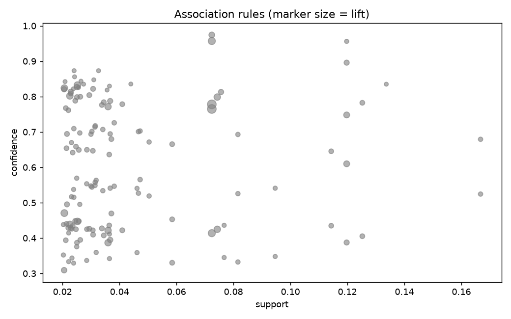

# market-basket-analysis

Frequent itemsets and association rules with a from-scratch Apriori, plus a simple next-item recommender.

## Task

Find which products are bought together and turn that into recommendations.

## Approach

- Baskets are generated from item popularity plus planted bundles (pasta set, snacks, diapers and wipes, bread and butter, coffee and sugar).
- `apriori` is a level-wise search with the subset-pruning property; `association_rules` computes support, confidence, lift and leverage.
- `recommend` scores items missing from a basket by the best matching rule.
- Tests check supports and lift on a hand-made example and that the planted bundles are recovered.

## Results



- 12,000 baskets, 276 frequent itemsets, 141 rules (confidence at least 0.3, lift at least 1.5).
- Top rules: salsa -> beer, chips (lift 8.2, confidence 0.78); beer, chips -> salsa (lift 8.2, confidence 0.76); beer, salsa -> chips (lift 5.5, confidence 0.96).
- For a basket with pasta and tomato sauce the recommendation is cheese.

## Run

```bash
pip install -r requirements.txt
python run.py      # generates data, runs the analysis, writes reports/
pytest             # unit tests
```

## Layout

```
src/data.py     data generation (fixed seed, no downloads)
src/core.py     analysis / model code
run.py          end-to-end script
tests/          unit tests
reports/        figures and summary.json produced by run.py
```

## Notes

The data is generated by `src/data.py` with a fixed random seed, so the numbers above are reproducible. It is synthetic: it is meant to show the method, and results on real data will differ.

Stack: pandas, matplotlib (Apriori is plain Python).
